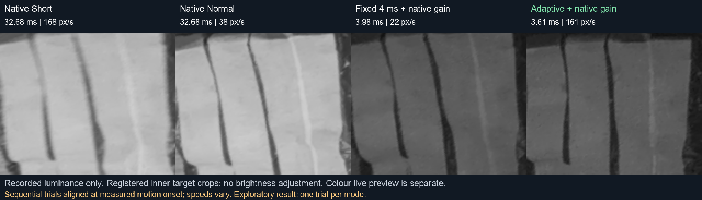

# Road Camera Exposure

Русский · [English](README.md)

Экспериментальное управление выдержкой камеры Raspberry Pi. При движении отслеживаемой мишени алгоритм сокращает выдержку, после остановки возвращает штатную автоэкспозицию. Усилением управляет камера. Трансляция **цветная**; трекер использует яркостный канал.

[](assets/results/target-motion.mp4)

[Смотреть видео](assets/results/target-motion.mp4) · [Галерея](assets/results/index.html) · [Методика и ограничения](docs/results.ru.md)

## Результат измерения


| Режим | Фактическая выдержка в движении | Медиана ширины линии | Кадров при 150–250 пикселях/с |
| --- | --- | --- | --- |
| Штатный Short | 32,680 мс | 5,50 пикселя | 117 |
| Штатный Normal | 32,680 мс | 6,375 пикселя | 100 |
| Постоянные 4 мс + штатное усиление | 3,981 мс | 3,00 пикселя | 60 |
| Адаптивный + штатное усиление | 2,779–7,989 мс | 4,00 пикселя | 69 |

В общем диапазоне скоростей адаптивный режим дал линию **на 27,3% уже штатного Short и на 37,3% уже Normal**. Постоянные 4 мс резче в движении. Адаптивный после остановки вернул штатные 32,680 мс. Это один последовательный комнатный опыт на режим с ручным движением и зависимыми кадрами. Он не доказывает статистическую значимость, эффективность на дороге или улучшение детекции. Усы графика — квартили кадров, а не доверительные интервалы.

## Что входит и поддерживается

- Независимые трекер на NumPy, выбор выдержки и контроль применения команд.
- Адаптер Picamera2 IMX708, цветной MJPEG-кроп, ограниченная проверочная запись.
- Конфигурация, измерение AWB, реальные метаданные, офлайн-анализ и тесты.

Исходная программа проверена на **Pi 5 + Camera Module 3 Standard / IMX708**. Реорганизованный пакет проверен офлайн и с имитацией камеры; первый реальный запуск ещё нужно проверить. Другие камеры требуют адаптера. Оценка движения всей дороги, детекция мусора и автоматическая дорожная калибровка не реализованы.

## Попробовать без камеры

Python 3.10+, команды из корня репозитория:

```sh
python -m venv .venv
source .venv/bin/activate
# Вместо source в Windows PowerShell: .\.venv\Scripts\Activate.ps1
python -m pip install -e .
roadcam simulate
roadcam run --config configs/module3.example.json
python -m unittest discover -s tests -v
```

Команда `run` выше проверяет конфигурацию без открытия камеры. Симуляция проверяет синтетическую обратную связь, но не качество изображения.

## Raspberry Pi и другие камеры

Полная [инструкция установки](docs/installation.ru.md). После установки получите опорный снимок и настройте созданную конфигурацию под сцену:

```sh
roadcam inspect
mkdir -p runs
roadcam reference --config configs/module3.example.json --output runs/reference --run-camera
roadcam run --config runs/reference/config.json
roadcam run --config runs/reference/config.json --output runs/demo-001 --run-camera --allow-lab
```

По умолчанию трансляция доступна на самой Pi: <http://127.0.0.1:8000/>. Инструкция объясняет доступ из доверенной локальной сети; авторизации и TLS нет. Пример области отслеживания условный — его нужно совместить с контрастной мишенью.

Для другой камеры есть [инструкция интеграции](docs/camera-adapters.ru.md) и [шаблон SDK](examples/custom_camera.py). CLI пока поддерживает только IMX708. Новому адаптеру нужны управление, перевод единиц, временные метки и проверка фактических настроек. Одного RTSP-адреса недостаточно.

## Ресурсы


На измеренной Pi 5 отдельно трекер и выбор выдержки при 8,3 проверках/с занимали **16,4% одного ядра**, около 4,1% мощности четырёх ядер. Средний вызов: 15,54 мс. Захват, ISP, JPEG и HTTP не включены.

| Что измерено | Затраты |
| --- | --- |
| Алгоритм вместе с Python/NumPy | 28–29 МиБ; примерно 5–6 МиБ сверх исходного процесса |
| Весь процесс цветной трансляции | RSS 94,97 МиБ; пик 96,92 МиБ |
| Сам алгоритм | Один поток ОС, без видеокодера, видеодекодера, GPU и NPU |

Буферы ядра/ISP могут не входить в RSS. Короткие замеры не гарантируют максимальную задержку и отсутствие утечек при длительной работе. [Условия замера](docs/results.ru.md).

## Документация

- [Установка](docs/installation.ru.md)
- [Другие камеры](docs/camera-adapters.ru.md)
- [Архитектура](docs/architecture.ru.md)
- [Результаты](docs/results.ru.md)
- [Решение проблем](docs/troubleshooting.ru.md)
- [Разработка и воспроизводимость](docs/development.md)
- [Первичные источники](docs/references.md)

Далее нужны повторные испытания со случайным порядком режимов, движение на дороге, смена света и проверка детектора. Экспериментальный проект не предназначен для критичной к безопасности навигации.

[Лицензия MIT](LICENSE).
