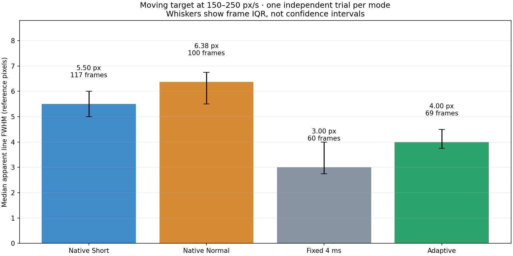
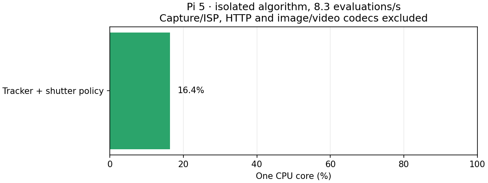

# Измерения и материалы

[English](results.md) · [Главная](../README.ru.md) · [Галерея](../assets/results/index.html)

Записано 26 октября 2026 года на Pi 5 + Camera Module 3 Standard/IMX708. [Измерения и версии](../assets/results/measurements.json). Полные комнатные записи не распространяются. Агрегаты позволяют перестроить графики, но не повторить анализ сырых кадров. После реорганизации пакет на оборудовании не запускался.

## Движение

Один последовательный опыт на режим, контрастная карточка двигалась вручную. Аффинная регистрация совмещала тёмную линию; видимая горизонтальная ширина FWHM сравнивалась при 150–250 пикселях эталона в секунду. Плохие совпадения и соседние интервалы сенсора >50 мс исключались.

| Режим | Медиана FWHM | Квартили кадров | Пригодных кадров |
| --- | --- | --- | --- |
| Штатный Short | 5,50 пикселя | 5–6 | 117 |
| Штатный Normal | 6,375 пикселя | 5,5–6,75 | 100 |
| Постоянные 4 мс | 3,00 пикселя | 2,75–4 | 60 |
| Адаптивный | 4,00 пикселя | 3,75–4,5 | 69 |

Адаптивные линии на 27,3%/37,3% уже штатных Short/Normal. Постоянные 4 мс резче в движении. Реальная штатная выдержка в обоих профилях — 32,680 мс: название Short не обеспечило короткую выдержку при этом свете. Постоянный режим применил 3,981 мс, адаптивный в движении — 2,779–7,989 мс. После остановки адаптивный вернул штатные 32,680 мс. Постоянное усиление достигало 16, восстановленное штатное — примерно 9,39. Это наблюдаемый компромисс, а не откалиброванное улучшение SNR.

Адаптивная проверка: 436 кадров, 270 принятых аффинных совпадений, 264 кадра для скорости, 69 в диапазоне сравнения. Все 15 новых команд подтверждены метаданными; 18/18 общей сводки включают три команды подготовки. Максимальный интервал сенсора — 266,6 мс. Номинальные 30 fps не означают такую же частоту анализа/просмотра.

FWHM включает толщину линии, оптику, ISP и пересчёт пикселей, а не только смаз. Кадры зависимы, доли отбраковки различаются, порядок не случайный, движение/свет могут меняться. Анализ исследовательский. Статистическая значимость, доверительные интервалы независимых повторов, полнота детекции и размеры дорожных объектов не подтверждены. Усы графика — квартили кадров.

## Видео

[Смотреть MP4](../assets/results/target-motion.mp4) · [Происхождение](../assets/results/video-provenance.json)

Пять секунд, четыре панели: реальные 8-битные яркостные кадры, обрезанные до внутренней части карточки и совмещённые, без окружающей сцены. Панели записаны отдельно и совмещены по началу движения; конкретные кадры не одновременны и скорости могут отличаться. Указаны реальные выдержка/скорость. Плохие совпадения чёрные. Яркость не нормализована, промежуточные кадры не выдуманы. Постер иллюстративный, график использует общий диапазон скоростей. Живая трансляция цветная; историческое видео измерений яркостное.

## Ресурсы

Отдельно трекер/выдержка, данные уже в памяти: 84 вызова через 0,12 с, 10,080075 с реального времени и 1,652639 с CPU — 16,4% одного ядра / 4,1% четырёхъядерной Pi 5. Непрерывный замер 505 вызовов: среднее 15,542 мс, медиана 15,243 мс, p95 21,329 мс, максимум 23,706 мс. Это не гарантированный худший случай.

Изолированный процесс при потоковой подаче: около 28–29 МиБ с Python/NumPy, на 5–6 МиБ больше исходных 23 МиБ. Предзагрузка 101 кадра добавляла около 18 МиБ данных, это не состояние потокового алгоритма. Полная цветная трансляция: RSS 94,97 МиБ, пик 96,92 МиБ, PSS 86,43 МиБ, swap 0. Буферы ядра/DMA/ISP могут не входить в RSS. Короткий замер не доказывает отсутствие длительных утечек.

Сам алгоритм использовал один поток ОС, без видеокодера/декодера, GPU/NPU. CSI/ISP, JPEG и HTTP исключены из CPU-замера. Декодер IP-камеры добавит нагрузку.

## Продолжение

[Команды разработки](development.md) перестраивают графики агрегатов. В новых опытах сохраняйте конфигурацию, версии, команды/реальные настройки, время и критерии исключения. Нужны повторные испытания со случайным порядком режимов при одинаковых скоростях, свете, фокусе; статистика по опытам, контраст/шум, точность детектора. Крепление, обзор, масштаб пикселей и дорожное движение измеряются отдельно. Этот опыт не подтверждает двухполосную дорожную сцену.
